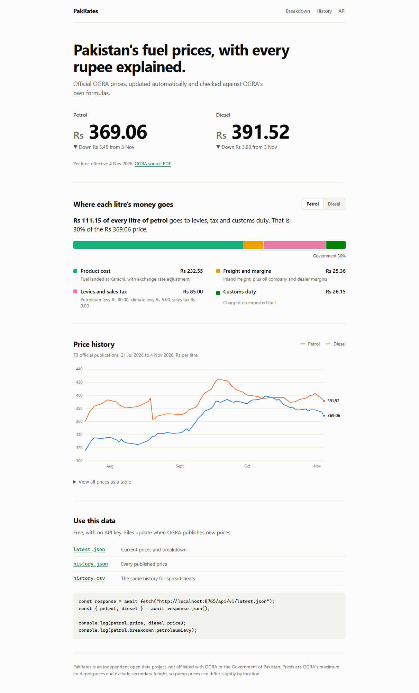

# PakRates

**Pakistan's official petrol and diesel prices, with every rupee explained.**

PakRates reads OGRA's price publications, checks them against OGRA's own formulas, and publishes the result as free open data. No API key, no sign-up, no server.

[Live site](https://zainkhan-bit.github.io/PakRates/) · [latest.json](docs/api/v1/latest.json) · [history.csv](docs/api/v1/history.csv)



## Why

News tells you the price changed. It rarely tells you why. OGRA publishes the full breakdown of each litre, but only as PDFs. PakRates turns those PDFs into data anyone can use.

On 4 November 2026, Rs 111.15 of a Rs 369.06 litre of petrol, or 30%, was levies and customs duty.

## Use the data

Base URL: `https://zainkhan-bit.github.io/PakRates/api/v1/`

| File | What it has |
|---|---|
| `latest.json` | Current prices, change from the previous publication, and breakdown |
| `history.json` | Every published price since 21 July 2026 |
| `history.csv` | The same history for spreadsheets |

```js
const response = await fetch("https://zainkhan-bit.github.io/PakRates/api/v1/latest.json");
const { petrol, diesel } = await response.json();

console.log(petrol.price);                   // 369.06
console.log(petrol.breakdown.petroleumLevy); // 80
```

<details>
<summary>Example response</summary>

```json
{
  "effectiveDate": "2026-11-04",
  "effectiveTime": "00:00",
  "currency": "PKR",
  "unit": "litre",
  "source": "https://www.ogra.org.pk/download/17909?lang=en",
  "petrol": {
    "price": 369.06,
    "breakdown": {
      "productCost": 232.55,
      "customsDuty": 26.15,
      "freightAndMargins": 25.36,
      "petroleumLevy": 80,
      "climateLevy": 5,
      "salesTax": 0
    },
    "market": {
      "costAndFreightUsdPerBarrel": 141.01,
      "exchangeRatePkrPerUsd": 276.91
    },
    "previousPrice": 374.51,
    "change": -5.45
  },
  "diesel": { "...": "same shape as petrol" }
}
```

</details>

## How accuracy is protected

A wrong fuel price is worse than a missing one, so PakRates refuses to publish numbers it cannot verify.

1. **OGRA's formulas are recomputed.** Each PDF row has a formula such as `V={P+S+T+U}`. PakRates recalculates every one. If a layout change misaligns a column, the numbers stop adding up and the record is rejected.
2. **The total is checked a second way.** Rows are also found by label, and their sum must match the printed total.
3. **Failures are loud.** A rejected publication is left out and the GitHub Action fails.
4. **Every record links to its source PDF**, so anyone can check it.

## What the numbers mean

- **Price** is OGRA's maximum ex-depot price, excluding secondary freight. Pump prices can differ slightly by location.
- **productCost** is the landed cost at Karachi plus the exchange rate adjustment, minus any levy collected through refineries.
- **freightAndMargins** is IFEM plus the oil marketing company and dealer margins.
- **petroleumLevy** is the full levy OGRA lists, including any part collected through refineries.

The history starts on 21 July 2026 because that is as far back as OGRA's price publications go. The older OGRA notifications sampled so far (2019, 2024 and 2026) cover kerosene only.

## Run it yourself

Needs Node.js 20 or newer.

```bash
npm ci
npm test
npm run update
```

`npm run update` adds any new publications to `docs/api/v1`. The site is plain HTML in `docs/`.

A GitHub Action runs this twice a day and commits new data.

## Contributing

Issues and pull requests are welcome. Good next steps:

- Electricity tariffs and a bill calculator from NEPRA data
- Kerosene and light diesel oil prices
- An Urdu version of the site

If OGRA changes its PDF layout, add the new PDF to `test/fixtures` with a test.

## Data source and license

All prices come from the [Oil and Gas Regulatory Authority](https://www.ogra.org.pk/price-publications). PakRates is independent and is not affiliated with OGRA or the Government of Pakistan. OGRA's site asks that its content is not used to train AI models. PakRates does not do this, and please respect that request when reusing the data.

Code is under the [MIT License](LICENSE).
